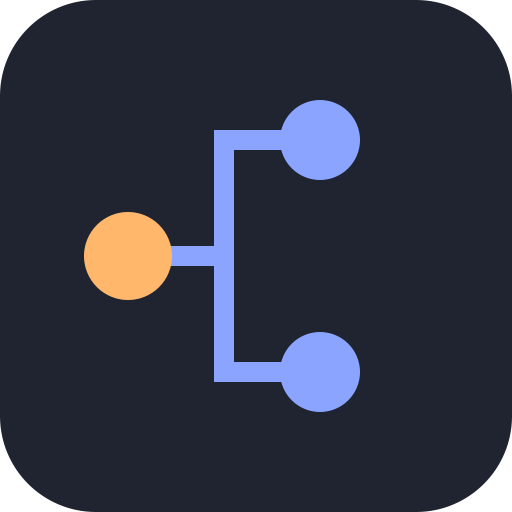

<div align="center">



# Agent tree

**See every agent your Claude Code session is running, live, in one place**

For each session you see its subagents and side sessions, what each one is working on, how much it spent, and if it is waiting for you. In a tree, live, while they run.

https://github.com/user-attachments/assets/44ef8b02-0e60-4137-b985-e88accf5466a

</div>

## Install

```bash
claude plugin marketplace add behnamazimi/agent-tree
claude plugin install agent-tree@behnamazimi-plugins
```

## Quickstart

Open the pane:

```text
/agent-tree
```

Run a task that splits across agents. The tree updates in the pane, above the prompt, and in the status line. A toast appears when an agent waits on you.

## Commands

Each command applies to the session you run it in.

| Command                    | What it does                                                                                                    |
| -------------------------- | --------------------------------------------------------------------------------------------------------------- |
| `/agent-tree`              | Open the pane. `/agent-tree view` does the same.                                                                |
| `/agent-tree on`           | Record this session.                                                                                            |
| `/agent-tree off`          | Stop recording this session.                                                                                    |
| `/agent-tree all`          | Show folded finished agents, or fold them again.                                                                |
| `/agent-tree open <agent>` | Jump to that agent's conversation. Match an id prefix, part of its name, or `main`. Hover a card to see its id. |
| `/agent-tree export`       | Copy a Markdown outline of the whole tree. The pane's Copy button does the same.                                |

## Notes

- **Costs:** shown when Claude Code reports what the session spent. Otherwise each node shows the tokens it used.
- **Desktop app:** one conversation view, so `open <agent>` prints that agent's task, latest action, and result.
- **Side sessions:** recorded when the Claude desktop app starts one.

## Privacy

Agent tree only watches. It makes no network requests and sends nothing anywhere. Every event is passed on unchanged, so a prompt, a tool call, or a permission stays as it was. The tree stays in Claude Code's store on your machine, and the clipboard is written only when you export or press Copy.

The longer account is in [PRIVACY.md](PRIVACY.md).

## License

MIT
